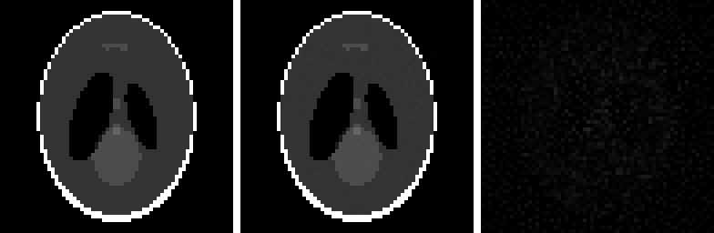
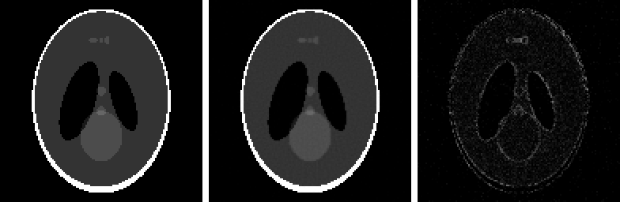
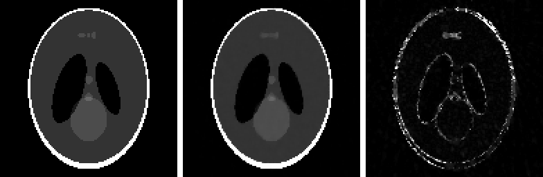
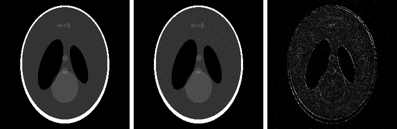

# Sparse-View CT Image Reconstruction

Reconstructing 2D cross-section images from **sparse, noisy computed tomography (CT) projections** with iterative numerical methods in **MATLAB / GNU Octave**.

I built this for the competitive project in the *Numerical Methods* (Metode Numerice) course. My implementation is in [`reconstruct.m`](reconstruct.m). The driver, reference operators, evaluation code, Docker setup and practice data come from the course's starter package.

## The problem

The scanner measures line integrals of the unknown image `x` (N² pixels) along rays at a few angles:

```math
b = A x + \eta, \qquad \eta \sim \mathcal{N}(0, \sigma^2)
```

Several things make this hard:

- **Underdetermined system.** In tiers 2–4 there are fewer measurements `m` than unknowns `N²` (for example, 3,640 measurements for 16,384 pixels in tier 3), so infinitely many images fit the data.
- **Ill-conditioning.** The singular values of `A` decay gradually, so naive inversion amplifies the noise.
- **No explicit matrix.** `A` is only available as the operators `forward_op` (`Ax`) and `adjoint_op` (`Aᵀb`).
- **Restricted tools.** Built-in solvers (`pcg`, `lsqr`, `gmres`, …), decompositions (`svd`, `eig`, …), `radon`/`iradon`, `\` on large systems, `inv`/`pinv` and the toolboxes are forbidden. Everything is written from primitive linear algebra.
- **Two kinds of phantom.** *Piecewise-constant* phantoms need sharp edges. *Smooth-gradient* phantoms need continuous shading without staircase artefacts. One algorithm has to handle both.

The score for each phantom is `0.6 · PSNR + 0.4 · (100 · SSIM)`, and each reconstruction must finish in under 120 s on a single thread.

## Overview of the solution

`reconstruct.m` picks a strategy from the problem's metadata (`N`, number of angles, sinogram size, `σ`, `x_max`):

```text
            ┌──────────── N ≤ 64 ? ────────────┐
            │ yes (overdetermined)              │ no (sparse / underdetermined)
            ▼                                   ▼
  Conjugate Gradient on the           Primal-Dual Hybrid Gradient (Chambolle–Pock)
  Tikhonov normal equations           with Total Variation regularization
  (AᵀA + λI) x = Aᵀb                  + box constraint [x_min, x_max]
            │                         + adaptive λ per iteration
            ▼                         + optional Huber smoothing
     clip to [x_min, x_max]                        │
            └──────────────┬────────────────────────┘
                           ▼
                   reconstructed image
```

### Cached projection operators (used by every tier)

The iterative methods call `A` and `Aᵀ` hundreds or thousands of times. The provided operators recompute the pixel grid and every pixel's detector bin on every call. I reimplemented the same pixel-driven geometry (nearest-bin projection of pixel centres onto the detector line) in `proiectie_directa` / `retroproiectie`. The bin indices for every angle are computed once in `geometrie_memorata` and kept in `persistent` variables, so later calls skip that work:

- **forward projection** is one `accumarray` per angle, summing the pixels that land in each bin;
- **back-projection** is one indexed gather per angle, giving each pixel the value of its bin.

The result is identical to `forward_op` / `adjoint_op`, just much faster when called in a loop.

The sections below go through the tiers one at a time. Each image shows the **ground truth** (left), **my reconstruction** (middle) and the **absolute error** (right, saturated at 10% of the intensity range) for that tier's practice phantom. Runtimes were measured single-threaded in GNU Octave 11.1 inside the provided Docker image.

---

## Tier 1: Warm-up (5%)

**Setup:** 64×64 grid, 90 angles, ≈8,190 measurements for 4,096 unknowns.

There are more measurements than unknowns, so the system is **overdetermined** and a quadratic (Tikhonov) regularizer is enough:

```math
\min_x \|Ax - b\|^2 + \lambda \|x\|^2 \;\Longleftrightarrow\; (A^\top A + \lambda I)\,x = A^\top b
```

The system is symmetric positive definite, so I solve it with a hand-written **Conjugate Gradient** solver. Each iteration applies `(AᵀA + λI)` matrix-free, as one forward projection, one back-projection and a scaled vector add.

- `λ = 1e-4 + 1.5·σ`: the regularization grows with the noise level.
- At most 180 iterations, or until the residual drops below `1e-6`.
- The result is clipped to the known intensity range `[x_min, x_max]`.



| Iterations | PSNR | SSIM | Score | Runtime |
|--:|--:|--:|--:|--:|
| 180 | 51.06 dB | 0.9936 | 70.38 | 1.8 s |

---

## Tier 2: Standard (15%)

**Setup:** 128×128 grid, 60 angles, ≈10,920 measurements for 16,384 unknowns.

The system is now **underdetermined**. Tikhonov would blur the edges, so from this tier on I minimize a **Total Variation** regularized objective with a box constraint:

```math
\min_{x \,\in\, [x_{\min}, x_{\max}]} \;\tfrac12 \|Ax - b\|^2 \;+\; \lambda_{TV} \sum_{i} \big\|(\nabla x)_i\big\|_2
```

TV (Rudin–Osher–Fatemi) favours images with a sparse gradient. It removes noise and streak artefacts but keeps sharp edges. The objective is non-smooth, so I use the **Primal-Dual Hybrid Gradient** algorithm (Chambolle–Pock). It splits the problem into simple steps that each have a closed form:

| Step | Update |
|:--|:--|
| Extrapolation | `x̄ = 2·xₖ − xₖ₋₁` |
| Data dual | `p ← (p + τ(A x̄ − b)) / (1 + τ)` (prox of the quadratic data term) |
| TV dual | `q ← q + τ ∇x̄`, then project each `qᵢ` onto the ball of radius `λ` (isotropic TV) |
| Primal | `x ← clip(x − τ(Aᵀp + ∇ᵀq), x_min, x_max)` |

- **Step size:** `τ = 0.99 / √(‖A‖² + 8)`. Here `8` bounds `‖∇‖²` for forward differences, and `‖A‖` is estimated with a few iterations of the **power method** on `AᵀA` (no `svd`/`eigs`). The factor 0.99 keeps the step strictly inside the convergence condition `τ²‖K‖² < 1`.
- **Box constraint:** projecting onto `[x_min, x_max]` uses the known intensity range from the data file. This removes negative values and overshoot.
- **No semi-convergence problem:** unlike plain CGLS/SIRT, PDHG converges to the regularized minimizer and doesn't start fitting the noise, so a fixed, generous iteration count is safe.

**Parameters for this tier:** `λ_TV = 0.14 + 3.0σ`, 900 iterations. With 60 angles the data still constrains the image well, so moderate regularization and fewer iterations are enough.

**Huber-TV for smooth phantoms.** When the metadata suggests a smooth phantom (based on the intensity range `x_max` and the coefficient of variation of the sinogram), the TV term is replaced by its **Huber-smoothed** version. In the dual this is a single extra scaling, `q ← q / (1 + τα)`, before the projection:

- small gradients are penalized quadratically (smooth, no staircase),
- large gradients are still penalized linearly (edges stay sharp).

In this tier `α = 0.35` and `λ_TV` is multiplied by 0.75 to compensate.



| Iterations | PSNR | SSIM | Score | Runtime |
|--:|--:|--:|--:|--:|
| 900 | 44.36 dB | 0.9911 | 66.26 | 12.3 s |

---

## Tier 3: Sparse (35%)

**Setup:** 128×128 grid, only **20 angles**, ≈3,640 measurements for 16,384 unknowns.

This is the hardest sampling ratio: less than a quarter of the measurements needed. Without strong regularization, the reconstruction fills up with streak artefacts between the few projection directions. Same PDHG + TV algorithm as in Tier 2, but:

- **stronger regularization:** `λ_TV = 0.18 + 3.0σ`;
- **more iterations:** 2777, because information spreads slowly from so few views;
- **Huber smoothing** for smooth phantoms with `α = 0.18` and `λ_TV × 0.90`.

**Adaptive λ: piecewise-constant vs. smooth phantoms.** This is where the two phantom types differ the most. Too much TV on a smooth phantom gives the *staircase effect*. Too little on a piecewise-constant phantom leaves noise in the flat regions. Instead of one compromise value, `λ` is adjusted at every PDHG iteration (in all of tiers 2–4) from the current image:

```math
c = \frac{\text{mean}|\nabla \bar x|}{\max|\nabla \bar x|}, \qquad
\lambda_k = \max\big(\lambda_{TV}\,(1 - a\,c),\; 0.05\,\lambda_{TV}\big), \qquad
a = 0.85\,(1 - \min(1, 15\sigma))
```

- In a **piecewise-constant** image, the gradient is zero almost everywhere and large on a few edges, so `c` is small and `λ` stays close to full strength.
- In a **smooth-gradient** image, the gradient is spread over the whole image, so `c` grows and `λ` is reduced, which preserves the fine shading.
- At **high noise** (`σ ≥ 1/15`), `a → 0` and the adaptation turns off, because a strong regularizer is needed anyway.



| Iterations | PSNR | SSIM | Score | Runtime |
|--:|--:|--:|--:|--:|
| 2777 | 37.78 dB | 0.9924 | 62.37 | 15.1 s |

---

## Tier 4: Large Sparse (45%)

**Setup:** 256×256 grid, 30 angles, ≈10,860 measurements for 65,536 unknowns.

This tier has the largest weight and the most unknowns. It is both sparse and expensive: each operator call touches 65,536 pixels × 30 angles, and thousands of calls are needed. This is where the cached projection operators matter most and keep the run well under the 120 s limit.

- `λ_TV = 0.15 + 3.5σ`: the coefficient on the noise level `σ` is the largest of all tiers;
- 2600 iterations;
- **Huber smoothing** for smooth phantoms with `α = 0.14` and `λ_TV × 0.92`;
- the same adaptive λ as in Tier 3.



| Iterations | PSNR | SSIM | Score | Runtime |
|--:|--:|--:|--:|--:|
| 2600 | 40.84 dB | 0.9675 | 63.21 | 60.6 s |

**Fallback for other setups.** In tiers 2–4, if the sinogram is much larger than expected (a denser detector), there are more measurements per pixel, so `reconstruct.m` switches to a weaker regularizer (`λ_TV = 0.012 … 0.025 + 1.5 … 2σ`) and fewer iterations (450 – 1100).

---

All numbers above come from the public practice phantoms only. The competition phantoms are hidden and not included here.

## Project structure

```text
reconstruct.m        My reconstruction implementation (the only file I wrote)
run_tier.m           Provided experiment runner
operators/           Provided forward / adjoint operators
utils/               Provided I/O and visualization helpers
evaluation/          Provided scoring functions (PSNR / SSIM)
data/practice/       Provided practice inputs and ground-truth images
examples/            Reconstructions and ground-truth comparisons
Dockerfile           GNU Octave 11.1 environment
docker-compose.yml   Containerized run configurations
Makefile             Convenience tasks (make + Docker)
STUDENT_PACKAGE.md   Original README of the course starter package
```

## Running a practice reconstruction

The simplest cross-platform option is **Docker** (with Docker Compose). From the repository root:

```sh
docker compose run --build --rm run
```

This runs the Tier 1 practice example and writes the reconstructed image and a report to `results/`. To run another tier, such as Tier 3:

```sh
docker compose run --build --rm run-tier octave --no-gui --no-window-system --eval "tier=3; use_practice=true; run_tier"
```

If you have `make`, there are shortcuts for the four practice tiers:

```sh
make p1   # Tier 1: 64×64,   90 angles
make p2   # Tier 2: 128×128, 60 angles
make p3   # Tier 3: 128×128, 20 angles
make p4   # Tier 4: 256×256, 30 angles
```

You can also run it straight from GNU Octave: open the repository folder and run `tier = 3; use_practice = true; run_tier`.

## Constraints respected

- Only primitive operations: array arithmetic, `norm`, `dot`, `accumarray`, indexing.
- No built-in iterative solvers, no matrix decompositions, no `radon`/`iradon`, no toolboxes, no `\`/`inv`/`pinv` on large systems.
- `A` and `AᵀA` are never formed; everything is matrix-free.
- Every reconstruction finishes in under 120 s on a single thread.

## Attribution and scope

This repository separates my implementation (`reconstruct.m`) from the **university-provided starter package**: the test harness, projection operators, evaluation code, Docker setup and practice datasets. The provided parts are kept so the reconstruction can be run and evaluated exactly as in the course.

## References

1. A. Chambolle, T. Pock, *A First-Order Primal-Dual Algorithm for Convex Problems with Applications to Imaging*, J. Math. Imaging Vis., 40, 2011.
2. L. I. Rudin, S. Osher, E. Fatemi, *Nonlinear Total Variation Based Noise Removal Algorithms*, Physica D, 60, 1992.
3. A. N. Tikhonov, *Solution of Incorrectly Formulated Problems and the Regularization Method*, Soviet Math. Doklady, 4, 1963.
4. M. R. Hestenes, E. Stiefel, *Methods of Conjugate Gradients for Solving Linear Systems*, J. Res. Nat. Bur. Standards, 49, 1952.
5. P. J. Huber, *Robust Estimation of a Location Parameter*, Ann. Math. Statist., 35, 1964.
